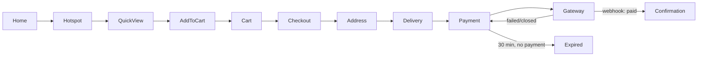
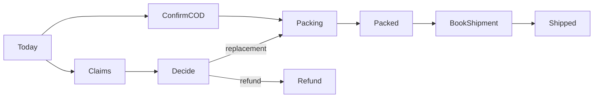

# App flow: Aanch

Checkpoint 2. **Status: approved 26 Nov 2026.** Rules behind these flows: [requirements.md](requirements.md).

## Screens

**Storefront**

| Screen | Purpose | Access |
|---|---|---|
| Home | Table from above, shop by meal, kiln calendar teaser, Chhaap, Clay to table, new firing | Public |
| Collection / listing | Grid or shelf view, filters, sort | Public |
| Search results | Same as listing, from the search box | Public |
| Product | Gallery, finish, size, stock and firing, Will it hold?, use profile, PIN check, pairs with | Public |
| Quick view | Product essentials in a dialog (from hotspots and cards) | Public |
| Kiln calendar | Current and next firings, stages, what's coming, notify-me | Public |
| Chhaap | The four prints, their technique and blocks, pieces in each | Public |
| Kiln Seconds | Seconds listing with flaw notes | Public |
| Studio, Studio notes | Story, process, journal posts | Public |
| No longer made | Archived product's page with similar pieces | Public |
| Help pages | Shipping, returns and breakage, care, contact and grievance, terms, privacy | Public |
| About this demo | What the project is, demo admin login, data resets | Public |
| Cart drawer, cart page | Lines, quantities, free-shipping progress, price or stock changes | Public |
| Checkout | Contact, address, delivery, gift, payment (focused layout) | Public |
| Order confirmation | Stamped confirmation, next steps, signed tracking link | Public, signed link |
| Order tracking | Timeline, shipment events, invoice, actions | Owner of order or signed link |
| Sign in, sign up, reset password | Account access | Public |
| Account: overview, orders, order detail, addresses, shelf, notify-me, demo inbox, privacy | Self-service | Customer |
| Report a breakage, request a return | Claim forms with photo upload | Customer or signed link |
| 404, 500 | "This page cracked in the kiln" with a way back | Public |

**Admin desk** (its own host, such as `aanch-admin.vercel.app`, later `admin.aanch.in`; staff sign-in realm, two-factor required)

| Screen | Purpose | Roles |
|---|---|---|
| Today | Queues: to pack, COD to confirm, claims and returns, low stock, firing status | All staff |
| Orders, order detail | Filter, act, refund, packing slip, shipment | Owner, Support (Ops: fulfilment actions) |
| Packing | Batch view of confirmed orders: slips, mark packed, book shipment | Owner, Operations |
| Claims and returns | Queue, photo review, decide | Owner, Support |
| Products, product editor | List and filters, editor with variants, images, profile and live drawing, lifecycle | Owner, Operations |
| Finishes, collections | Manage glazes, prints, collections | Owner, Operations |
| Firings, firing detail | Plan stages, contents, receive | Owner, Operations |
| Stock | Per-variant levels, ledger, adjustments, thresholds | Owner, Operations |
| Customers, customer detail | Profile, orders, notes, export or delete requests | Owner, Support |
| Discounts | Codes and usage | Owner |
| Reports | Sales, AOV, COD vs prepaid, refunds, RTO, GST summary, CSV export | Owner |
| Content | Home tables and hotspots, firing note | Owner, Operations |
| Staff and roles, email allowlist, settings | Access and store configuration | Owner |
| Audit log | Search and filter every sensitive change | Owner |

## Main journeys

### 1. Discover from the table and buy (prepaid)
1. Home shows the Thali table. The shopper taps the katori hotspot, and the quick view opens.
2. They pick the Jaal finish and **Add to cart**. The stamp lands on the cart icon.
3. Cart drawer, then **Checkout**. Contact (email, phone), or sign in.
4. Address: PIN first, which fills the city and state. Or **Use sample details**.
5. Delivery: estimate and shipping charge. Optional gift wrap and message, with a preview.
6. Payment: the test-mode notice, then the gateway sheet (UPI, card, netbanking, wallet).
7. The gateway's webhook confirms payment, and the order becomes *paid*.
8. Confirmation is stamped with the firing chop. The email appears in the demo inbox, and is also
   delivered if the address is allowlisted.

### 2. Browse, compare and decide
1. Shop, then Everyday Thali. Filters: Finish = Neel, Capacity ≥ 400 ml.
2. Switch to shelf view to compare the Dal Bowl and the Serving Bowl at true scale.
3. On the product page, choose a finish (the gallery swaps), then Will it hold? set to Dal, and the
   PIN check.
4. Add to cart, or save it to Your shelf.

### 3. Sold out, then back with the next firing
1. A variant shows *Sold out this firing* and **Notify me next firing**, along with the date from
   the kiln calendar.
2. The shopper enters an email (or it's taken from their account). This is rate-limited, and
   there's one request per email per variant.
3. Admin receives Firing No. 113, the stock lands, and the notify-me emails go out once.
4. The email links to the variant. The request is marked done.

### 4. Cash on delivery
1. Order ≤ ₹5,000 on a serviceable PIN, so **Pay on delivery** is offered with its ₹99 fee shown.
2. The order is placed and its stock taken. It appears in Today as *COD to confirm*.
3. Support confirms it, it's packed and shipped, and on delivery COD is collected.
4. If it's refused: *rto*, the stock returns when the parcel is back, and the order is cancelled.

### 5. Gift for a housewarming
1. At delivery, the shopper ships to a different address and adds gift wrap and a message.
2. The gift note is previewed as a printed card, without prices.
3. The invoice goes to the buyer's account and email. Prices never appear on anything the
   recipient sees. How the tax invoice travels with a gift parcel is confirmed at Checkpoint 3.

### 6. Arrived broken
1. Order detail (signed in, or through the signed link) shows **Report a breakage** for 48 h after
   delivery.
2. The shopper picks the pieces and uploads 1–4 photos (checked, metadata stripped) and a note.
3. The claim appears in Claims. Support reviews the photos and approves a replacement (a ₹0
   order) or a refund, or rejects it with a reason.
4. The customer sees the decision on the order and in the email.

### 7. Account basics
- **Sign up:** after an order or on its own. The guest cart merges on sign-in.
- **Orders:** list, detail, invoice PDF, cancel (until packed), return (7 days, unused).
- **Privacy:** download my data (JSON). Delete my account: confirm, then the profile is
  anonymised and invoices are kept.

### 8. Admin: a studio morning
1. Today: 6 to pack, 2 COD to confirm, 1 claim, Neel Katori low.
2. Confirm the CODs. Packing: print the slips, mark packed, book a shipment (mock tracking number).
3. Review the claim and approve the replacement. It joins the packing queue.

### 9. Admin: plan and receive a firing
1. Firings, then New. Pick the variants and the expected quantities, and set the stage dates. The
   kiln calendar updates.
2. Move it through the stages as the work happens.
3. **Receive:** enter the actual quantities, including any studio breakage. The stock ledger and
   stock levels update, and the notify-me emails queue.

### 10. Admin: add, archive or delete a product
1. New product: draft details, profile points (the live drawing updates), variants (finish × size,
   price, SKU), images, legal details.
2. **Activate** checks that it's complete: at least one active variant with price, stock entry
   and image, plus HSN, rate and profile.
3. **Archive** hides it and keeps the URL as *No longer made*. **Delete** is offered only if it was
   never ordered.

### 11. Admin: month end
Reports, then GST summary. Pick the month and see the taxable value and tax by HSN and by state
(CGST, SGST, IGST), net of credit notes. Export as CSV. The export is logged.

## Navigation

- **Header:** logo, Shop (mega menu: by meal, by piece, by finish, Kiln Seconds), New firing,
  Kiln calendar, Studio, then search, shelf, account and cart. Phones get a full-screen menu and
  the same icons.
- **Footer (pallu):** shop links, help pages, studio, kiln calendar sign-up, and the demo line.
- **Checkout:** logo and Back to cart only. No strip, no full footer.
- **Account:** a left side menu (tabs on phones).
- **Admin:** a left sidebar grouped as Today / Sell (Orders, Packing, Claims) / Make (Products,
  Firings, Stock, Finishes, Collections) / People (Customers, Discounts) / Studio (Reports,
  Content, Staff, Settings, Audit log). Items the role can't use aren't shown, and the server
  refuses them anyway.
- Deep links: every listing filter and admin table filter lives in the URL.

## States

| Screen | Loading | Empty | Error | Success |
|---|---|---|---|---|
| Listing | Skeleton cards shaped like each piece's profile | "No pieces match" with Clear filters | Retry inline, and filters are kept | Results count |
| Product | Profile-shaped image placeholder | n/a | "Couldn't load stock" with a disabled add button | Added: stamp, then the drawer opens |
| Cart | Line placeholders | "Nothing on the table yet" with Shop the thali | A line's price or stock changed: the change is shown on the line | n/a |
| Checkout payment | Pay button busy, locked against double submit | n/a | Payment failed or closed: try again or choose another method, and the cart is kept | Confirmation |
| Kiln calendar | Curve skeleton | "No firing scheduled" with Notify me | Last known stage, with a note | n/a |
| Account orders | Rows | "No orders yet" with Shop | Retry | n/a |
| Admin tables | Row skeletons | Specific to each queue ("Nothing to pack") | Inline error with Retry, filters kept | A toast naming the action ("Order AAN-1042 packed") with Undo where it's safe |

## Edge paths

- **Payment:** failed, closed, or a webhook arriving before or after the redirect, or more than
  once. The order state changes only on the server, from the webhook or a server-side status
  check while the confirmation page polls. A payment after expiry with no stock left is refunded
  automatically.
- **Stock:** runs out between cart and payment, so that line is blocked at checkout with the
  change shown. A reservation expires, so the order is expired and the shopper can retry.
- **PIN:** not serviceable, so there's no delivery and the shopper is asked for another address.
  COD-ineligible, so prepaid only.
- **Discount:** expired, below the minimum, used up, or an ineligible cart. Each gets a specific
  message under the field.
- **Session:** expires mid-checkout, so the shopper signs in again and keeps the cart and the
  entered address.
- **Permission:** a staff member without a role on that screen gets a 403 page with no detail. A
  customer opening another customer's order gets a 404, never 403, so the order's existence isn't
  revealed.
- **Uploads:** wrong type or over 5 MB, so the upload is refused and the reason shown.
- **Archived product:** opened from an old link, so the shopper sees *No longer made* with
  alternatives. In a cart, the line is flagged and blocked at checkout.
- **Admin:** two staff edit the same product, so the second save is refused with "changed since
  you opened it". A refund above the Support limit asks for an Owner.
- **Offline or slow network:** the cart and checkout show a retryable error, and video posters
  stay as stills.

## Open questions

None.
